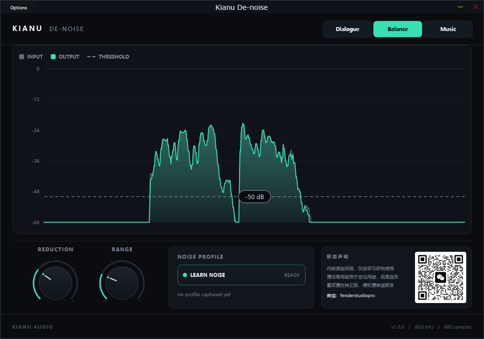
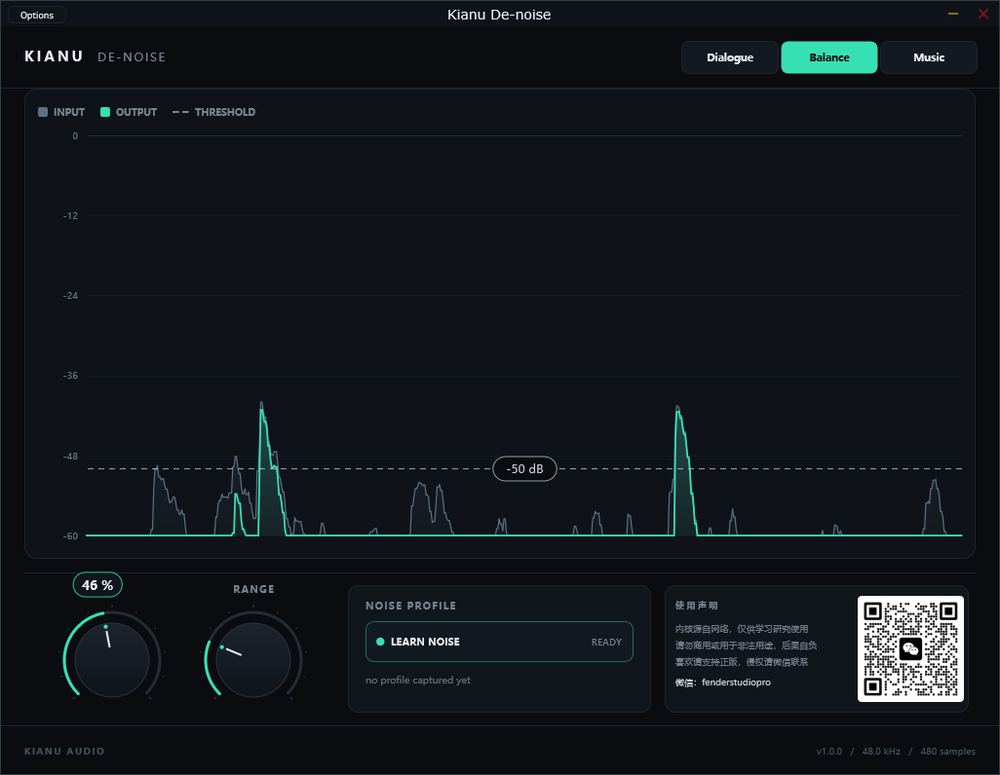

# Kianu De-noise

A real-time noise reduction plugin for voice and dialogue — VST3 + standalone app, Windows x64.

[中文说明](README.zh-CN.md) · [Download](https://github.com/heisan980429-lab/Kianu-De-noise/releases) · [License](LICENSE)



---

## Features

- **Real-time spectral-subtraction denoiser** — low latency, built for live streaming, tracking and dialogue cleanup
- **Noise learning** — hit `LEARN NOISE` to capture the current noise floor; the profile is saved with the project
- **Three working modes** — Dialogue / Balance / Music
- **Visual comparison** — the scope draws INPUT (grey) and OUTPUT (teal) together, so you can see exactly what got removed
- **Drag the threshold right on the waveform** — the dashed line is the threshold; drag it up or down, double-click to reset
- **Value read-out while you turn** — shown on the dial's outer ring, hidden the moment you let go

| Parameter | Range | Description |
|---|---|---|
| Threshold | −60 … 0 dB | Noise below this level is processed |
| Reduction | 0 … 100 % | Amount of reduction |
| Range | 0 … 60 dB | Maximum attenuation |

## Installation

1. Grab `Kianu De-noise-1.0.0.exe` (≈ 36 MB) from [Releases](../../releases)
2. Quit your DAW, then run the installer and follow the steps. It places `Kianu De-noise.vst3` in:

   ```
   C:\Program Files\Common Files\VST3\
   ```

3. Restart your host and rescan the VST3 folder (Cubase / Nuendo / Studio One / Reaper / FL Studio / Audition / WaveLab…)
4. The installer also ships the standalone app `Kianu De-noise.exe` — no host required

> The installer is not code-signed. If Windows shows "Windows protected your PC", click **More info → Run anyway**.

## Usage

1. Play a section that contains noise only (no voice) and hit `LEARN NOISE` — it finishes automatically in 3 seconds
2. Play your actual material and check that the grey INPUT curve sits below the dashed threshold line
3. Drag the dashed line up or down to set the threshold, or turn `REDUCTION` / `RANGE` for strength and maximum attenuation
4. Pick a mode to match the material: Dialogue for speech, Balance for mixed content, Music for music



## Requirements

- Windows 10 / 11, 64-bit
- A VST3-capable host, or the bundled standalone app

## Feedback

Bugs, feature requests, anything else — WeChat: **fenderstudiopro**


## Disclaimer

The processing kernel originates from the internet and is provided for study and research only. Do not use it commercially or for unlawful purposes; you are responsible for the consequences. If you like it, please support the original work. For copyright concerns, contact us on WeChat.
Full terms: [LICENSE](LICENSE).

## Build from source

Requires Visual Studio 2022 (MSVC) and CMake 3.22+.

```bash
cmake -B build -DCMAKE_BUILD_TYPE=Release
cmake --build build --config Release
```

The built artefacts land in:

```
build\VVoxClone_artefacts\Release\VST3\Kianu De-noise.vst3\
build\VVoxClone_artefacts\Release\Standalone\Kianu De-noise.exe
```

JUCE is **not** vendored in this repository: if there is no `JUCE/` folder, CMake fetches the pinned version `9.0.5` automatically on the first configure.

Run the tests with:

```bash
cd build
ctest -C Release --output-on-failure
```
