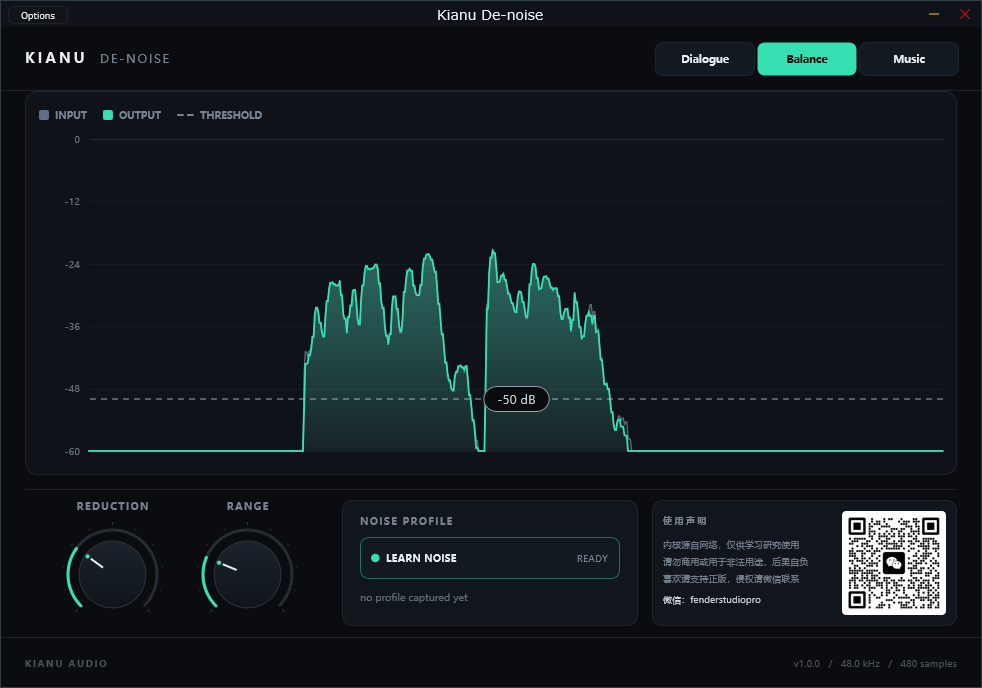
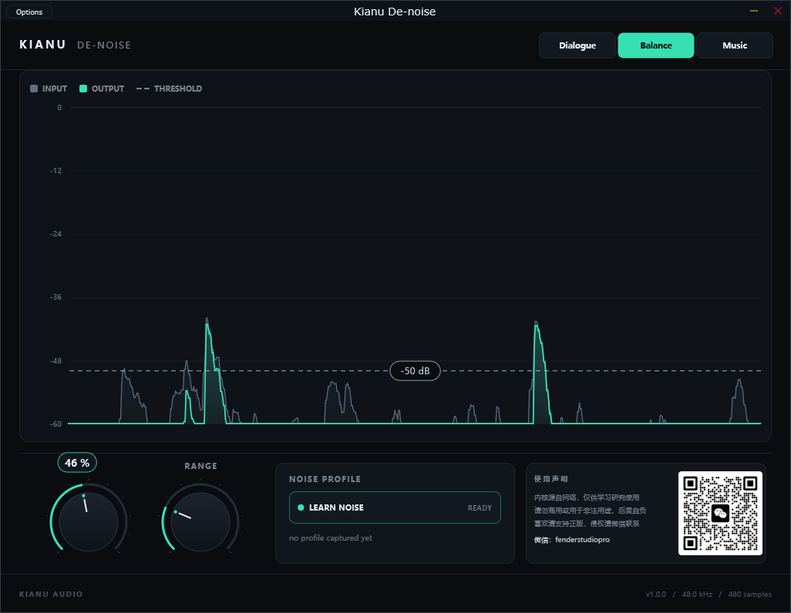

# Kianu De-noise

面向人声 / 对白的实时降噪插件（VST3 + 独立程序），Windows x64。

[English](README.md) · [下载](https://github.com/heisan980429-lab/Kianu-De-noise/releases) · [许可证](LICENSE)



---

## 功能

- **实时谱减降噪**：低延迟，适合直播、录音、后期对白清理
- **噪声学习**：点一下 `LEARN NOISE` 抓取当前底噪轮廓，随工程保存
- **三档工作模式**：Dialogue（对白）/ Balance（均衡）/ Music（音乐）
- **可视化对比**：波形区同时显示 INPUT（灰）与 OUTPUT（青绿），一眼看出被削掉的部分
- **阈值直接在波形上拖**：虚线即阈值，上下拖动即可改，双击复位
- **旋钮拖动时显示数值**：显示在旋钮外圈上，松手即收起，不占版面

| 参数 | 范围 | 说明 |
|---|---|---|
| Threshold | −60 … 0 dB | 低于此电平的噪声被处理 |
| Reduction | 0 … 100 % | 降噪强度 |
| Range | 0 … 60 dB | 最大衰减量 |

## 安装

1. 到 [Releases](../../releases) 下载 `Kianu De-noise-1.0.0.exe`（约 36 MB）
2. 先退出宿主（DAW），双击安装包，一路下一步；插件会被放到：

   ```
   C:\Program Files\Common Files\VST3\
   ```

3. 重开宿主，重新扫描 VST3 插件（Cubase / Nuendo / Studio One / Reaper / FL Studio / Audition / WaveLab…）
4. 安装包里同时带独立程序 `Kianu De-noise.exe`，不装宿主也能直接用

> 安装包没有代码签名。Windows 首次运行若提示「已保护你的电脑」，点「更多信息 → 仍要运行」即可。

## 使用

1. 先播一段「只有噪声、没有人声」的素材，点 `LEARN NOISE`（3 秒自动结束）
2. 播放正式素材，看波形上的灰色 INPUT 曲线是否被压在虚线以下
3. 拖虚线上 / 下调整阈值，或转 `REDUCTION` / `RANGE` 调节强度与最大衰减
4. 三种模式按素材切换：人声用 Dialogue，混合内容用 Balance，音乐用 Music



## 系统要求

- Windows 10 / 11 x64
- 支持 VST3 的宿主，或直接使用独立程序

## 反馈

有问题、想要新功能，加微信：**fenderstudiopro**


## 声明

内核源自网络，仅供学习研究使用。请勿商用或用于非法用途，后果自负。喜欢请支持正版；侵权问题请微信联系我们处理。
完整条款见 [LICENSE](LICENSE)。

## 从源码构建

需要 Visual Studio 2022（MSVC）与 CMake 3.22+。

```bash
cmake -B build -DCMAKE_BUILD_TYPE=Release
cmake --build build --config Release
```

产物位置：

```
build\VVoxClone_artefacts\Release\VST3\Kianu De-noise.vst3\
build\VVoxClone_artefacts\Release\Standalone\Kianu De-noise.exe
```

仓库里**不包含** JUCE：没有 `JUCE/` 目录时，CMake 首次 configure 会自动拉取固定版本 `9.0.5`。

跑测试：

```bash
cd build
ctest -C Release --output-on-failure
```
